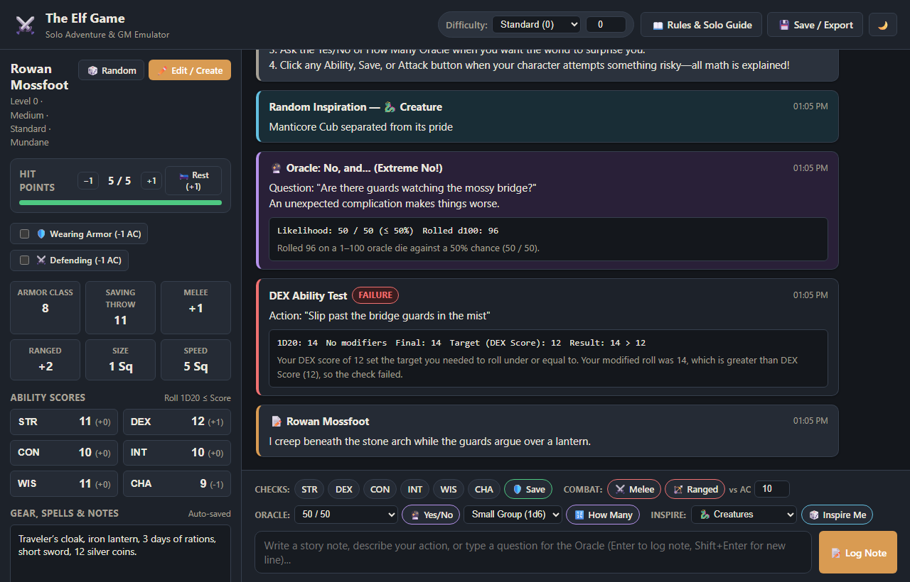
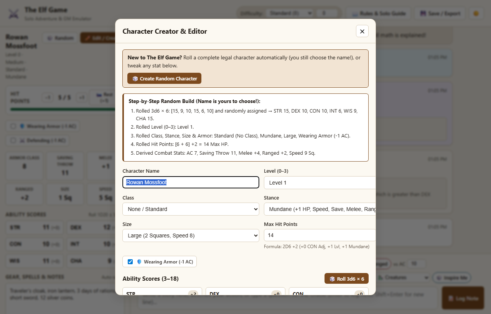
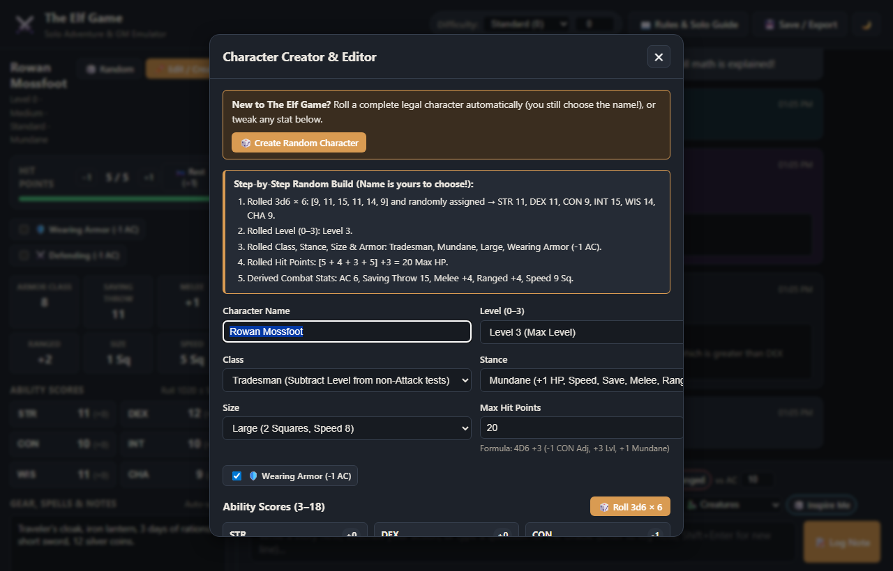
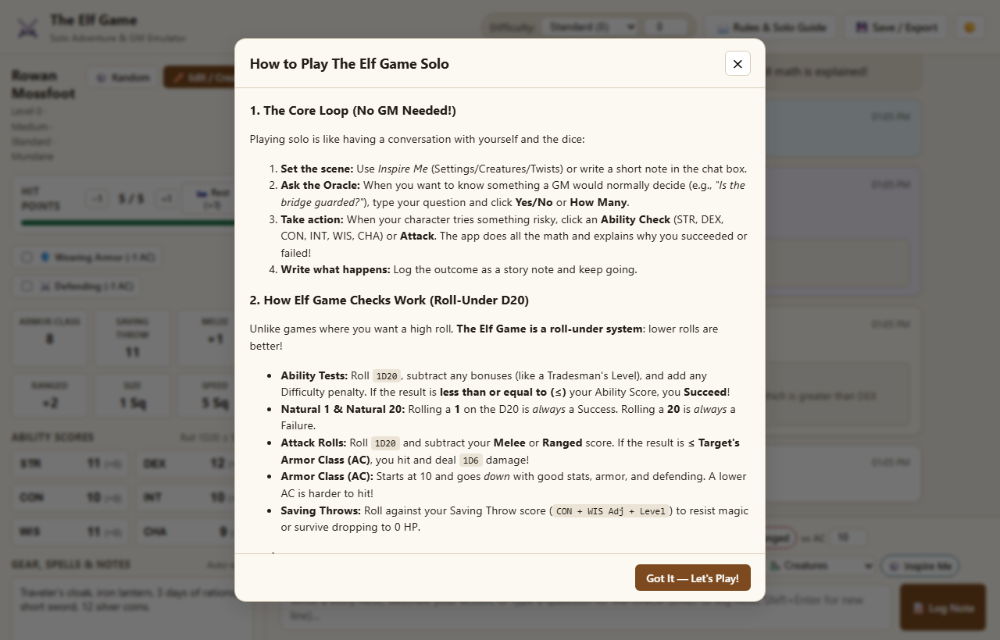
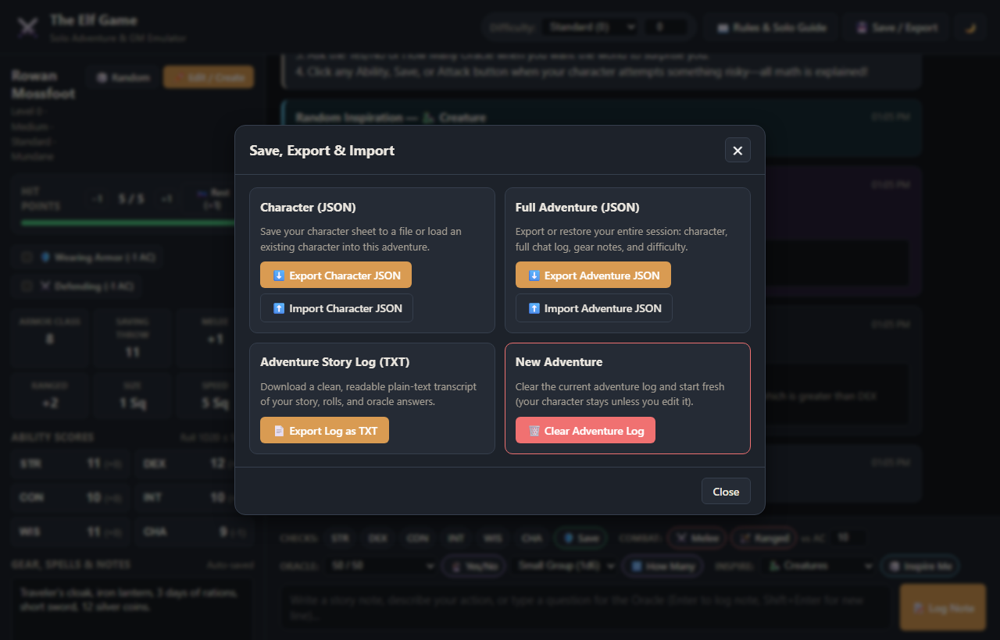

# The Elf Game — Solo GM Emulator

A single-player browser game & Game Master emulator for **The Elf Game** (by S&A Baudelaire). Play solo in an interactive chat log with automatic dice math, explained check results, Yes/No & How Many Oracles, random fantasy inspiration tables, a full Character Creator & Randomizer, and JSON/TXT export.

---

## Screenshots

### Main Adventure Workspace — Light Mode vs Dark Mode

| Light Mode | Dark Mode |
| :---: | :---: |
|  |  |

### Character Creator & Step-by-Step Randomizer

| Light Mode | Dark Mode |
| :---: | :---: |
|  |  |

### Rules & Solo Guide / Save, Export & Import

| Rules & Solo Guide (Light Mode) | Save, Export & Import (Dark Mode) |
| :---: | :---: |
|  |  |

---

## Features

- **Solo Chat & GM Emulator**: Log story notes, roll **Ability Checks** (`STR`, `DEX`, `CON`, `INT`, `WIS`, `CHA`), **Saving Throws**, **Melee / Ranged Attacks**, **Yes/No Oracles**, **How Many Oracles**, and **Random Inspiration** (`Creatures`, `Treasures`, `Magic Items`, `Spell Effects`, `Settings`, `NPCs & Classes`, `Plot Twists`).
- **Explained Check Results**: Every roll shows the exact D20, class/difficulty modifiers, target number, and a plain-English explanation of why you succeeded or failed (including Natural 1 & Natural 20 rules).
- **On-the-Fly Difficulty**: Switch between `Easy (-3)`, `Standard (0)`, `Hard (+3)`, `Heroic (+6)`, or enter any custom roll modifier.
- **Character Creator & Randomizer**: Roll `3d6 × 6`, roll Hit Points with the exact Elf Game formula, edit any stat or level (`0–3`) at will, or click **🎲 Random** to build a complete legal character step-by-step while keeping the name yours to choose.
- **Export & Import**: Save/load Characters (`.json`), full Adventures (`.json`), or readable Adventure Logs (`.txt`), with automatic `localStorage` persistence.
- **AI Agent Support**: Includes [`AGENTS.md`](AGENTS.md) so AI assistants can generate valid, legal Character JSON files on request.

## Running Locally

Open `index.html` directly in any modern browser, or serve the folder with any static HTTP server.
